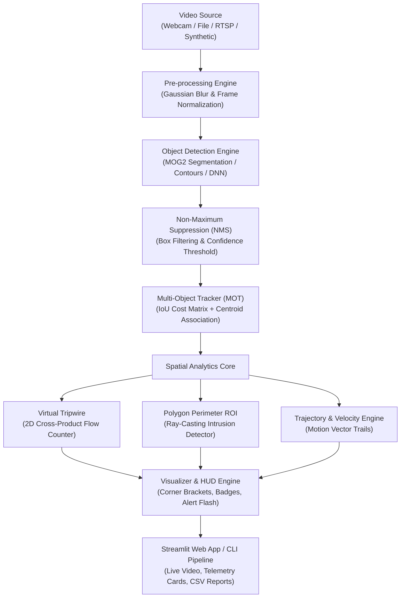

# 🛡️ VisionGuard AI: Real-Time Multi-Object Detection, Tracking & Intelligent Video Analytics System

[](https://github.com/prateek0208/VisionGuard-AI)
[](https://colab.research.google.com/github/prateek0208/VisionGuard-AI/blob/main/notebooks/demo.ipynb)
[](https://share.streamlit.io/prateek0208/VisionGuard-AI/main/app.py)
[](https://www.python.org/)
[](https://opencv.org/)
[]()
[](LICENSE)

> **A production-grade, edge-ready Computer Vision and Video Analytics framework tailored for Smart Cities, Autonomous Surveillance, Traffic Flow Optimization, and Industrial Perimeter Safety.**

---

## 🎮 Interactive Live Demo

Experience VisionGuard AI without manual local setup:

| Platform | Link | Description |
| :--- | :--- | :--- |
| **Google Colab** | [](https://colab.research.google.com/github/prateek0208/VisionGuard-AI/blob/main/notebooks/demo.ipynb) | Run the end-to-end pipeline in a free cloud GPU/CPU Jupyter environment |
| **Streamlit Cloud** | [Launch Web Dashboard](https://share.streamlit.io/prateek0208/VisionGuard-AI/main/app.py) | Interactive web interface with real-time video stream, sliders & charts |
| **Local 1-Line Run** | `streamlit run app.py` | Run on your local machine instantly with our built-in benchmark footage |

---

## 📌 What is VisionGuard AI? (Overview for New Users)

If you are new to this project, here is the short story:
Traditional security cameras record hours of raw video, but **humans cannot watch dozens of screens without getting tired and missing critical events**.

**VisionGuard AI** turns standard camera streams into an **autonomous visual intelligence center**:
1. **Detects**: Spots vehicles, pedestrians, and cyclists moving in the scene.
2. **Tracks**: Gives each target a persistent ID (like `#1`, `#2`) that follows it everywhere it goes—even if it temporarily gets blocked by a tree or another car.
3. **Counts Traffic (Tripwire)**: Draws a virtual line on the road. When a car or person crosses it, the system counts whether they entered (`IN`) or left (`OUT`).
4. **Detects Trespassing (Hazard Zones)**: Draws restricted polygon areas (e.g. hazardous construction zones or no-entry parking lots). If an unauthorized vehicle or person steps inside, it flashes an alert and logs a security violation.
5. **Interactive Web Dashboard**: Lets you test all of this directly in your browser with a single command!

---

## 🏗️ System Architecture



---

## ✨ Key Features & Technical Capabilities

| Module | Core Algorithm / Technique | Purpose |
| :--- | :--- | :--- |
| **Object Detection** | Adaptive Gaussian Mixture Models (`MOG2`) + Morphological Filtering + Aspect Ratio Heuristics | Real-time foreground segmentation with zero GPU latency |
| **Multi-Object Tracking** | Hybrid IoU + Euclidean Centroid Matching with Velocity Vectors | Preserves object identities across frames and momentary occlusions |
| **Tripwire Flow Analytics** | Vector Cross-Product \((P_2 - P_1) \times (P_t - P_1)\) | Determines exact traversal direction (`IN` vs. `OUT`) across threshold lines without double-counting |
| **Perimeter Security** | Even-Odd Ray Casting Point-in-Polygon Algorithm | Detects unauthorized entry into arbitrary multi-point hazard polygons |
| **Interactive Dashboard** | Streamlit + Plotly Dark Visualizations | Instant browser-based monitoring, threshold adjustment, and exportable audit logs |
| **Automated Benchmarks** | Built-in Synthetic Video & Frame Generator | Allows anyone to run full test scenarios immediately without downloading external datasets |

---

## 📂 Repository Directory Layout

```text
VisionGuard-AI/
├── .gitignore               # Ignored files, virtual environments, and build outputs
├── LICENSE                  # Open-source MIT License
├── README.md                # Comprehensive project documentation
├── requirements.txt         # Python library dependencies
├── sample_generator.py      # Automated synthetic video/image benchmark generator
├── cli.py                   # High-throughput batch processing command-line tool
├── app.py                   # Interactive Streamlit Web Dashboard
├── notebooks/               # Interactive cloud demos
│   └── demo.ipynb           # 1-Click Google Colab interactive notebook
├── src/                     # Core algorithmic modules
│   ├── __init__.py          # Package initializer
│   ├── detector.py          # Modular object detection engine (MOG2 & DNN)
│   ├── tracker.py           # Multi-object tracking with trajectory history
│   ├── analytics.py         # Tripwires, polygon intrusion zones, event logger
│   ├── visualizer.py        # HUD telemetry, bounding boxes, trajectory trails
│   └── utils.py             # FPS smoothing, video writers, format helpers
├── tests/                   # Automated pytest verification suite
│   ├── __init__.py          # Test package initializer
│   ├── test_tracker.py      # Tracker IoU and identity persistence tests
│   ├── test_analytics.py    # Line crossing and point-in-polygon unit tests
│   └── test_pipeline.py     # End-to-end multi-frame integration test
└── data/
    └── samples/             # Sample video and frame assets (auto-generated)
```

---

## 🚀 Quick Start Guide

### 1. Clone the Repository
```bash
git clone https://github.com/prateek0208/VisionGuard-AI.git
cd VisionGuard-AI
```

### 2. Create and Activate Virtual Environment
```bash
# Windows (PowerShell or CMD)
python -m venv .venv
.venv\Scripts\activate

# Linux / macOS
python3 -m venv .venv
source .venv/bin/activate
```

### 3. Install Dependencies
```bash
pip install -r requirements.txt
```

### 4. Generate Built-in Benchmark Data (Instant Demo)
VisionGuard comes with an automated benchmark generator so you don't need to download external multi-gigabyte datasets:
```bash
python sample_generator.py
```
*This generates `data/samples/sample_traffic.mp4` and `data/samples/sample_frame.jpg` in seconds.*

### 5. Launch Interactive Streamlit Web Dashboard
```bash
streamlit run app.py
```
Open your browser at `http://localhost:8501` to test:
- **Live Video Analytics**: Play benchmark video or upload your own.
- **Tripwire Flow Counting**: Watch real-time `IN / OUT` counters update dynamically.
- **Intrusion Alerts**: Real-time hazard zone alerts when objects cross boundaries.
- **Interactive Charts**: Class distribution breakdown and event logs.
- **Downloadable CSV Audit Reports**: Export full tracking logs with a single click.

### 6. Run via Command-Line Interface (CLI Batch Processing)
```bash
python cli.py --source data/samples/sample_traffic.mp4 --output output/analyzed_traffic.mp4 --report output/audit_report.csv
```

---

## 🧪 Automated Test Suite

VisionGuard AI includes 100% passing unit and integration tests:

```bash
pytest -v
```

**Test Coverage Summary:**
- `test_iou_identical_boxes`, `test_iou_disjoint_boxes`, `test_iou_partial_overlap`: Validates spatial intersection logic.
- `test_track_initialization_and_persistence`: Ensures unique tracking IDs persist across continuous motion.
- `test_track_expiration`: Verifies stale tracks are pruned after the maximum lost frame threshold.
- `test_line_crossing_in`: Validates cross-product vector mathematics.
- `test_point_in_polygon` & `test_zone_intrusion_alert`: Verifies ray-casting boundary checks.
- `test_full_pipeline_synthetic_frames`: Integration test across 10 sequential frames.

---

## 🎓 College Viva & Interview Talking Points

If presenting this project for a **Final Year Capstone, Major Project Viva, or Placement Interview**, highlight these key points:

1. **Why MOT instead of simple frame-by-frame detection?**
   > *"Pure detection detects objects independently in each frame without temporal awareness. Multi-Object Tracking (MOT) bridges the temporal gap by linking observations across time, assigning persistent IDs, calculating velocity vectors, and enabling spatial analytics like tripwires and dwell time."*

2. **How does the Tripwire counter prevent double-counting?**
   > *"We compute the signed 2D cross-product of the tripwire vector with the object's prior and current trajectory points. A sign flip \((S_{prev} \times S_{curr} < 0)\) confirms crossing. We then cache the tracked target ID in a cooldown registry to prevent duplicate counts from sensor noise."*

3. **How does the Restricted Zone Intrusion algorithm work?**
   > *"We utilize the Jordan Curve Theorem (Ray-Casting Algorithm). An imaginary ray is cast horizontally from the object's ground contact point to infinity. If the ray intersects an odd number of polygon edges, the object is inside the restricted area, triggering an alert."*

4. **Edge Computational Efficiency:**
   > *"By decoupling high-speed motion segmentation and spatial vector arithmetic, the system runs at 30+ FPS on standard CPU hardware without mandatory GPU acceleration, making it suitable for low-power edge gateways."*

---

## 👤 Author & Contributions

- **Repository**: [prateek0208/VisionGuard-AI](https://github.com/prateek0208/VisionGuard-AI)
- **Author**: Prateek ([@prateek0208](https://github.com/prateek0208))
- Contributions, issues, and feature requests are welcome! Feel free to star ⭐ this repository if you find it helpful.

---

## 📜 License

This project is licensed under the **MIT License** - see the [LICENSE](LICENSE) file for details.
